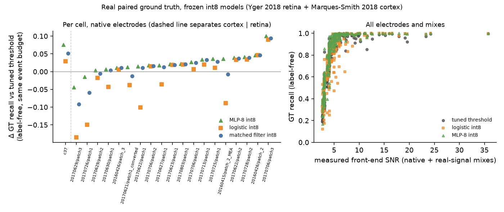
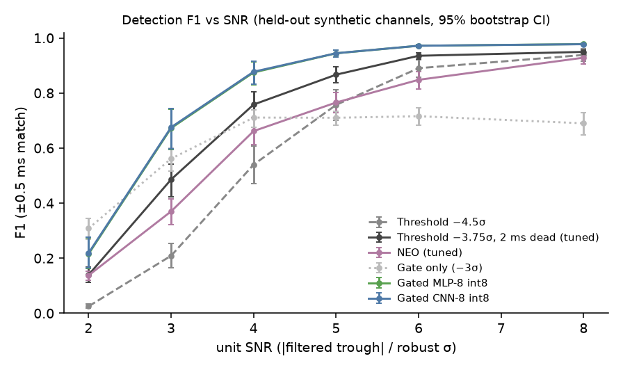
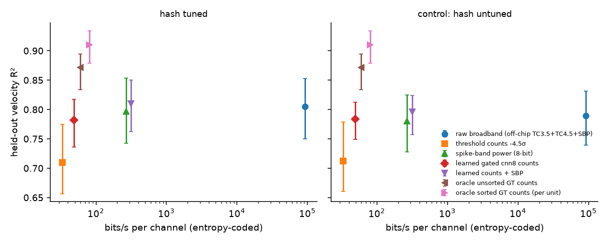
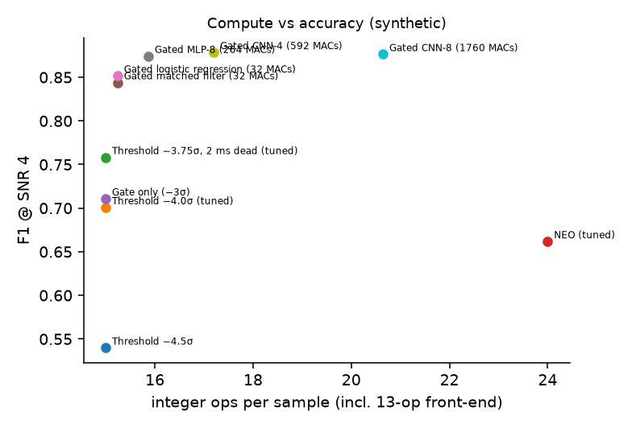
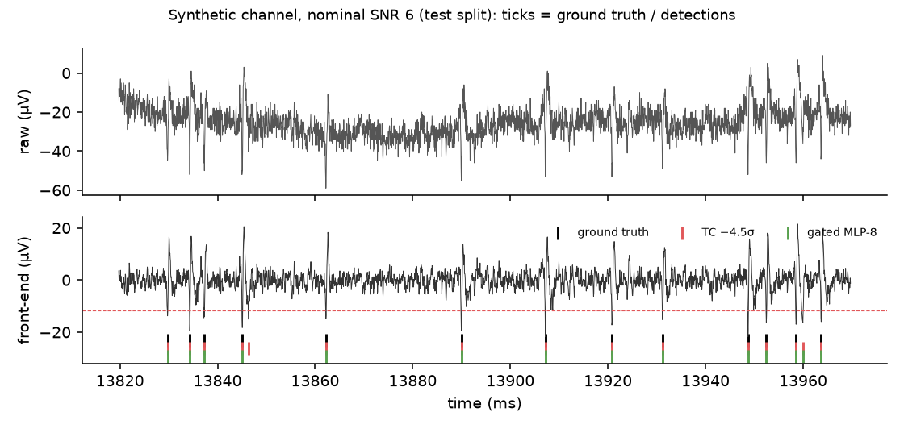

# spike-edge

**Spike detection and data reduction under implant-like compute and bandwidth limits.**
The pipeline is an integer-only front-end, then a −3σ gate, then a tiny int8 classifier that runs only
on gate candidates. The C version matches the Python bit for bit. Every learned model is compared with
strong threshold, NEO, logistic-regression and matched-filter baselines, and tested frozen on real
paired ground truth.



## TL;DR

* **Real paired ground truth: 20 cells, frozen models, never tuned on them.** The set is 19 retinal
  ganglion cells ([Yger et al. 2018](https://elifesciences.org/articles/34518), all recordings) and 1 cortical
  cell ([Marques-Smith et al. 2018](https://www.biorxiv.org/content/10.1101/370080v2)), over 77 electrodes.
  * *Deployable comparison.* A label-free rule sets the classifier to the tuned threshold's event count on
    the unlabelled calibration segment, then compares at that event budget. Gated int8 MLP-8 recovers more
    ground-truth spikes on **16/20 cells (2 ties, 2 losses)**, mean Δrecall **+0.025 [95% CI over cells
    +0.013, +0.038]**, sign test p = 0.001.
  * *Oracle comparison.* Against the best threshold for each electrode (k and dead time picked with labels
    at the same event rate), the gain shrinks to **+0.008 [−0.001, +0.017]** (7/11/2, p = 0.18). Most of
    the deployable win is robustness to a threshold that cannot be re-tuned without labels; little of it
    is detection that no threshold could match.
  * *Low SNR.* The gain grows as SNR falls: real-signal mixes below SNR 3.5 average +0.11.
  * *Caveat.* Precision cannot be measured: only one cell per recording is labelled.
* **It is mostly a learned matched filter, but the nonlinearity buys robustness.** On synthetic data a
  32-MAC logistic regression and a fixed matched filter come within 0.01–0.04 F1 of MLP-8 (264 MACs).
  CNNs up to 1760 MACs add nothing. On real cells, however, the logistic regression loses to the threshold
  on 8/20 cells (mean −0.017 [−0.047, +0.011]; worst −0.185). MLP-8 does not. Because the classifier
  runs on only about 49 candidates/s, MLP-8 costs **13 kMAC/s per channel**. For 1024 channels that is
  325 Mops/s in total, 307 of them the shift-add front-end. State is 136 KiB of SRAM, plus 364 B of
  shared weights.
* **Bandwidth (synthetic).** Learned counts cost **49 b/s/ch** with an adaptive arithmetic coder (69 with
  Huffman). They decode velocity at R² **0.780**, against 0.748 for the tuned threshold (ΔR² CI > 0 on
  3/3 seeds) and 0.760 for a threshold rate-matched label-free to the learned detector. 8-bit spike-band
  power reaches 0.797 but costs 270 b/s.

> Training and every operating point come from my own simulator. §0 is real data. §1–3 are synthetic
> (see [Limitations](#limitations)). The tables are generated by `scripts/04_report.py` from `results/*.json`.

## Pipeline

```
raw int16 @ 20 kHz ──► integer band-pass (~200 Hz–2.3 kHz, 13 add/sub/shift ops, no multiplies)
                        │
                        ├─► spike-band power: Σ|y| per 20 ms bin ──► 8-bit value
                        │
                        └─► gate: y < −3σ ──► trough search (0.75 ms) ──► 1 ms dead time
                                               │
                                               └─► 32-sample window ──► int8 classifier ──► spike / not spike
                                                                                            └─► count per 20 ms bin
```

* **Front-end** ([spike_edge/frontend.py](spike_edge/frontend.py), [c/spike_edge.c](c/spike_edge.c)): two
  first-order EMA high-passes and one EMA low-pass on Q8 integer state. Every detector uses it.
* **Crossings are negative-going only.** The front-end output is biphasic: a trough followed by a
  repolarisation peak. Triggering on the trough avoids double-counting the peak, but it misses
  positive-first waveforms. The simulator draws none of those; real data can contain them.
* **Calibration**: σ is a MAD estimate over the first 10 s, with no labels. Thresholds, the int8 input
  gain and the SBP scale are all set from it. Scoring starts after calibration.
* **Baselines**: threshold at −4.5σ; threshold with k tuned; threshold with k and dead time both tuned;
  NEO with C tuned. On the same gate candidates: int8 logistic regression (`lin32`) and a fixed matched
  filter (`tmpl`, the mean training spike). All are tuned on a validation split, never on test.
* **Learned** (`mlp8`, `cnn4`, `cnn8`): trained in float with PyTorch, then post-training quantised to
  int8 (per-channel weight scales, int32 accumulation, TFLite-style fixed-point requantisation). The int8
  change in val F1 is ≤ 0.0002.
* **Scoring**: one-to-one greedy matching within ±0.5 ms. Test channels use disjoint seeds, so templates,
  noise, spike trains and drift are disjoint. CIs come from a channel bootstrap.

## Results

### 0. Real paired ground truth (frozen models)

Two paired datasets are used. One cell per recording is labelled, and a cell is the unit of analysis.

* **Retina.** [Yger et al. 2018](https://elifesciences.org/articles/34518)
  ([Zenodo 1205233](https://zenodo.org/records/1205233), CC-BY-4.0): mouse retina in vitro on a
  252-electrode MEA at 20 kHz, with loose-patch spike times. All 19 recordings are used (≈31 GB,
  `scripts/fetch_yger.py`).
* **Cortex.** [Marques-Smith et al. 2018](https://www.biorxiv.org/content/10.1101/370080v2) (Google Drive,
  CC BY-SA 4.0): rat cortex in vivo on Neuropixels at 30 kHz, with juxtacellular spike times.
  * Of the 43 cells, I selected the 10 with a juxtacellular-triggered peak-to-peak ≥ 50 µV; the others are
    too faint for one channel.
  * Three of them (c14, c21, c26) are over 20 GB each and were skipped.
  * Four (c27, c28, c45, c46) were blocked by Google Drive's "Quota exceeded" limit on every attempt over
    six days; I did not work around the limit.
  * Of the three fetched (c19, c24, c37), only c37 has an electrode at ≥ 4σ after the front-end. **So cortex
    is n = 1.**
  * `scripts/fetch_marques_smith.py` streams each 384-channel file and keeps the 64 channels around the
    cell. The data is high-passed at 100 Hz (to match the Yger preprocessing) and resampled to 20 kHz.

Every electrode where the cell's front-end spike-triggered trough is ≥ 4σ on the full recording is an
independent implant channel. It is rescaled to σ = 5 counts and clipped to 10 bits.

* **Precision is unmeasurable.** Unmatched events may be spikes from other cells. So every detector is
  compared on ground-truth recall at the same event rate.
* **Oracle matched rate.** Each detector's threshold is swept. The threshold curve is the envelope over
  k and both 1 ms and 2 ms dead time. Recall is read at the frozen tuned-threshold event rate. This
  needs labels or a known firing rate.
* **Label-free rate-matched (primary).** The logit threshold is set so that the classifier emits as many
  events on the unlabelled calibration segment as the tuned threshold does. This is deployable. Realised
  event rates then stay within 0.94–1.08× of the threshold's (last column of the per-cell table).
* **Aggregation.** Each cell's Δrecall is the mean over its native electrodes. Cells are counted as
  wins/ties/losses (±0.01), with a bootstrap CI over cells and a two-sided sign test.
* **SNR sweep.** Rows other than "native" attenuate the electrode by a factor a and add real noise from
  a **different recording**. The first version used same-recording donors, whose noise is
  anti-correlated with the electrode (ρ ≈ −0.65, shared reference). Mixing then cancelled noise and
  *raised* SNR (e.g. 7.8 → 12.0). Cross-recording donors have |ρ| ≤ 0.07, and every mix now lands below
  native SNR.
* **SNR convention.** SNR is trough / σ, with peak-to-peak / σ in parentheses.

<!-- BEGIN real -->
**Across cells** (one sample per cell = mean over its native ≥4σ electrodes). Entries are mean Δrecall vs the tuned threshold [95% bootstrap CI over cells] · wins/ties/losses (±0.01) · two-sided sign test p.

| Scope | cells | comparison | MLP-8 | CNN-8 | logistic | matched filter |
|---|---:|---|---|---|---|---|
| all | 20 | label-free rate-matched (primary) | +0.025 [+0.013, +0.038] · 16/2/2 · p=0.00131 | +0.025 [+0.013, +0.039] · 16/3/1 · p=0.000275 | -0.017 [-0.047, +0.011] · 10/2/8 · p=0.815 | +0.014 [-0.003, +0.029] · 14/3/3 · p=0.0127 |
| all | 20 | oracle matched rate | +0.008 [-0.001, +0.017] · 7/11/2 · p=0.18 | +0.008 [-0.002, +0.018] · 7/11/2 · p=0.18 | -0.033 [-0.061, -0.008] · 4/6/10 · p=0.18 | -0.004 [-0.019, +0.009] · 6/10/4 · p=0.754 |
| Marques-Smith 2018 (rat cortex, Neuropixels) | 1 | label-free rate-matched (primary) | +0.076 [+0.076, +0.076] · 1/0/0 · p=1 | +0.082 [+0.082, +0.082] · 1/0/0 · p=1 | +0.029 [+0.029, +0.029] · 1/0/0 · p=1 | +0.051 [+0.051, +0.051] · 1/0/0 · p=1 |
| Marques-Smith 2018 (rat cortex, Neuropixels) | 1 | oracle matched rate | +0.055 [+0.055, +0.055] · 1/0/0 · p=1 | +0.064 [+0.064, +0.064] · 1/0/0 · p=1 | +0.015 [+0.015, +0.015] · 1/0/0 · p=1 | +0.037 [+0.037, +0.037] · 1/0/0 · p=1 |
| Yger 2018 (mouse retina, MEA) | 19 | label-free rate-matched (primary) | +0.023 [+0.011, +0.036] · 15/2/2 · p=0.00235 | +0.022 [+0.011, +0.035] · 15/3/1 · p=0.000519 | -0.019 [-0.051, +0.010] · 9/2/8 · p=1 | +0.012 [-0.006, +0.028] · 13/3/3 · p=0.0213 |
| Yger 2018 (mouse retina, MEA) | 19 | oracle matched rate | +0.006 [-0.002, +0.014] · 6/11/2 · p=0.289 | +0.005 [-0.004, +0.013] · 6/11/2 · p=0.289 | -0.036 [-0.065, -0.010] · 3/6/10 · p=0.0923 | -0.006 [-0.021, +0.007] · 5/10/4 · p=1 |

**Per cell** (label-free Δrecall vs tuned threshold, native electrodes):

| Cell | dataset | electrodes | SNR range | threshold recall | Δ MLP-8 | Δ CNN-8 | Δ logistic | Δ matched filter | MLP/threshold event-rate ratio |
|---|---|---:|---|---:|---:|---:|---:|---:|---:|
| cortex/c37 | Marques-Smith 2018 | 4 | 4.5–7.4 | 0.852 | +0.076 | +0.082 | +0.029 | +0.051 | 1.08 |
| 20160415/patch_2_MEA | Yger 2018 | 3 | 4.5–7.7 | 0.903 | +0.037 | +0.029 | -0.088 | -0.008 | 1.02 |
| 20160426/patch_2 | Yger 2018 | 1 | 4.7–4.7 | 0.947 | +0.047 | +0.047 | +0.047 | +0.047 | 1.01 |
| 20160426/patch_3 | Yger 2018 | 2 | 7.8–8.5 | 0.987 | +0.011 | +0.011 | +0.006 | +0.011 | 1.00 |
| 20170621/patch1_converted | Yger 2018 | 4 | 4.9–15.2 | 0.941 | +0.012 | +0.013 | -0.038 | -0.013 | 0.98 |
| 20170622/patch1 | Yger 2018 | 1 | 8.6–8.6 | 0.982 | +0.015 | +0.015 | -0.101 | +0.011 | 0.97 |
| 20170622/patch2 | Yger 2018 | 7 | 5.9–19.6 | 0.947 | +0.040 | +0.040 | +0.033 | +0.037 | 1.01 |
| 20170623/patch1 | Yger 2018 | 10 | 4.2–35.7 | 0.970 | +0.021 | +0.021 | +0.019 | +0.019 | 1.03 |
| 20170627/patch1 | Yger 2018 | 2 | 4.3–6.9 | 0.962 | +0.018 | +0.018 | -0.036 | +0.013 | 0.99 |
| 20170629/patch2 | Yger 2018 | 10 | 4.1–24.3 | 0.972 | +0.003 | +0.005 | -0.018 | -0.005 | 1.01 |
| 20170629/patch3 | Yger 2018 | 4 | 4.1–11.6 | 0.954 | -0.044 | -0.045 | -0.185 | -0.091 | 0.99 |
| 20170630/patch1 | Yger 2018 | 4 | 5.5–14.7 | 0.991 | +0.006 | +0.006 | -0.043 | +0.004 | 0.96 |
| 20170706/patch1 | Yger 2018 | 1 | 17.9–17.9 | 0.972 | +0.027 | +0.027 | +0.007 | +0.025 | 1.02 |
| 20170706/patch2 | Yger 2018 | 1 | 10.2–10.2 | 0.926 | +0.018 | +0.018 | +0.015 | +0.016 | 0.94 |
| 20170706/patch3 | Yger 2018 | 3 | 4.4–11.5 | 0.835 | +0.100 | +0.101 | +0.090 | +0.094 | 0.98 |
| 20170713/patch1 | Yger 2018 | 3 | 4.0–14.0 | 0.895 | +0.034 | +0.033 | +0.019 | +0.033 | 1.02 |
| 20170725/patch1 | Yger 2018 | 6 | 4.9–23.3 | 0.902 | +0.036 | +0.033 | +0.011 | +0.028 | 1.01 |
| 20170726/patch1 | Yger 2018 | 3 | 5.7–16.6 | 0.992 | -0.015 | -0.009 | -0.150 | -0.059 | 0.99 |
| 20170728/patch2 | Yger 2018 | 4 | 4.9–19.2 | 0.944 | +0.041 | +0.041 | +0.034 | +0.039 | 0.99 |
| 20170803/patch1 | Yger 2018 | 4 | 6.5–12.6 | 0.975 | +0.022 | +0.022 | +0.020 | +0.021 | 0.99 |

**Real-signal SNR sweep** (attenuated electrode + cross-recording noise; rows reuse the same cells, so not independent):

| measured SNR | conditions | mean label-free Δ MLP-8 | mean Δ logistic | mean Δ matched filter |
|---|---:|---:|---:|---:|
| 0–3.5 | 77 | +0.106 | +0.079 | +0.083 |
| 3.5–4.5 | 80 | +0.072 | +0.003 | +0.038 |
| 4.5–5.5 | 61 | +0.030 | -0.029 | +0.008 |
| 5.5–99 | 40 | +0.012 | -0.019 | +0.005 |

C pipeline bit-exact with Python on 77/77 native real electrodes. Cells with no electrode ≥ 4σ (excluded): 2 (cortex/c19, cortex/c24). Shortlisted electrodes dropped because the full recording was < 4σ: 7. Mixes dropped (SNR not below native): 0.
<!-- END real -->

### 1. Synthetic detection: detector × F1 × ops × memory

32 held-out channels × 30 s are scored per SNR level, with 1–2 ground-truth units per channel at the
nominal SNR ±10%. Column headers give the matching peak-to-peak SNR.

<!-- BEGIN detection -->
| Detector | ops/sample | M4 .rodata (B) | F1 @ SNR 2 (ptp 3.8) | F1 @ SNR 3 (ptp 5.5) | F1 @ SNR 4 (ptp 7.3) | F1 @ SNR 5 (ptp 9.0) | F1 @ SNR 6 (ptp 10.5) | F1 @ SNR 8 (ptp 14.0) |
|---|---:|---:|---|---|---|---|---|---|
| Threshold −4.5σ | 15.0 | 0 | 0.025 [0.02–0.03] | 0.209 [0.16–0.25] | 0.540 [0.47–0.61] | 0.757 [0.70–0.81] | 0.890 [0.86–0.92] | 0.938 [0.92–0.96] |
| Threshold −4.0σ (tuned) | 15.0 | 0 | 0.079 [0.06–0.10] | 0.381 [0.32–0.44] | 0.701 [0.64–0.76] | 0.840 [0.80–0.88] | 0.920 [0.90–0.94] | 0.904 [0.87–0.94] |
| Threshold −3.75σ, 2 ms dead (tuned) | 15.0 | 0 | 0.139 [0.11–0.17] | 0.486 [0.42–0.54] | 0.758 [0.71–0.80] | 0.867 [0.84–0.90] | 0.935 [0.92–0.95] | 0.950 [0.94–0.96] |
| NEO (tuned) | 24.0 | 0 | 0.138 [0.12–0.15] | 0.370 [0.32–0.42] | 0.662 [0.61–0.71] | 0.766 [0.73–0.80] | 0.848 [0.82–0.88] | 0.928 [0.91–0.95] |
| Gate only (−3σ) | 15.0 | 0 | 0.308 [0.27–0.34] | 0.561 [0.52–0.60] | 0.711 [0.68–0.74] | 0.710 [0.68–0.73] | 0.716 [0.68–0.75] | 0.690 [0.65–0.73] |
| Gated matched filter int8 (32 MACs) | 15.2 | 72 | 0.196 [0.14–0.25] | 0.630 [0.55–0.70] | 0.844 [0.79–0.89] | 0.928 [0.90–0.95] | 0.967 [0.96–0.97] | 0.978 [0.97–0.98] |
| Gated logistic regression int8 (32 MACs) | 15.2 | 72 | 0.224 [0.17–0.28] | 0.648 [0.57–0.71] | 0.852 [0.80–0.89] | 0.928 [0.91–0.94] | 0.963 [0.95–0.97] | 0.974 [0.97–0.98] |
| Gated MLP-8 int8 (264 MACs) | 15.9 | 428 | 0.213 [0.16–0.27] | 0.671 [0.59–0.74] | 0.874 [0.83–0.91] | 0.944 [0.93–0.96] | 0.972 [0.97–0.98] | 0.978 [0.97–0.98] |
| Gated CNN-4 int8 (592 MACs) | 17.2 | 284 | 0.232 [0.18–0.29] | 0.685 [0.61–0.75] | 0.879 [0.84–0.91] | 0.943 [0.93–0.96] | 0.970 [0.96–0.97] | 0.976 [0.97–0.98] |
| Gated CNN-8 int8 (1760 MACs) | 20.6 | 568 | 0.215 [0.16–0.27] | 0.673 [0.59–0.74] | 0.876 [0.83–0.91] | 0.945 [0.93–0.96] | 0.972 [0.97–0.98] | 0.978 [0.97–0.98] |

| Detector | P / R @ 2 | P / R @ 3 | P / R @ 4 | P / R @ 5 | P / R @ 6 | P / R @ 8 |
|---|---|---|---|---|---|---|
| Threshold −4.5σ | 0.78 / 0.01 | 0.97 / 0.12 | 0.99 / 0.37 | 0.98 / 0.62 | 0.98 / 0.82 | 0.91 / 0.97 |
| Threshold −4.0σ (tuned) | 0.69 / 0.04 | 0.91 / 0.24 | 0.96 / 0.55 | 0.95 / 0.75 | 0.94 / 0.91 | 0.84 / 0.98 |
| Threshold −3.75σ, 2 ms dead (tuned) | 0.60 / 0.08 | 0.85 / 0.34 | 0.94 / 0.63 | 0.94 / 0.80 | 0.95 / 0.92 | 0.95 / 0.95 |
| NEO (tuned) | 0.21 / 0.10 | 0.48 / 0.30 | 0.75 / 0.59 | 0.79 / 0.74 | 0.83 / 0.86 | 0.90 / 0.95 |
| Gate only (−3σ) | 0.32 / 0.29 | 0.49 / 0.66 | 0.61 / 0.86 | 0.57 / 0.94 | 0.56 / 0.98 | 0.53 / 0.98 |
| Gated matched filter int8 (32 MACs) | 0.79 / 0.11 | 0.93 / 0.48 | 0.97 / 0.75 | 0.97 / 0.89 | 0.97 / 0.96 | 0.97 / 0.98 |
| Gated logistic regression int8 (32 MACs) | 0.75 / 0.13 | 0.91 / 0.50 | 0.96 / 0.77 | 0.95 / 0.90 | 0.96 / 0.97 | 0.97 / 0.98 |
| Gated MLP-8 int8 (264 MACs) | 0.79 / 0.12 | 0.93 / 0.53 | 0.97 / 0.80 | 0.96 / 0.93 | 0.97 / 0.98 | 0.97 / 0.98 |
| Gated CNN-4 int8 (592 MACs) | 0.78 / 0.14 | 0.92 / 0.55 | 0.97 / 0.81 | 0.96 / 0.93 | 0.96 / 0.98 | 0.97 / 0.98 |
| Gated CNN-8 int8 (1760 MACs) | 0.79 / 0.12 | 0.93 / 0.53 | 0.97 / 0.80 | 0.96 / 0.93 | 0.97 / 0.98 | 0.97 / 0.98 |

| Gated classifier | MACs/inference | val F1 float | val F1 int8 |
|---|---:|---:|---:|
| tmpl | 32 | 0.9119 | 0.9119 |
| lin32 | 32 | 0.9104 | 0.9104 |
| mlp8 | 264 | 0.9165 | 0.9167 |
| cnn4 | 592 | 0.9164 | 0.9164 |
| cnn8 | 1760 | 0.9163 | 0.9164 |
<!-- END detection -->



### 1b. Robustness (synthetic)

* **No unit** on the channel: every event is a false positive.
* **Drift**: 300 s channels with ±25% amplitude drift over 60–300 s periods, thresholds calibrated on the
  first 10 s only.
* **Artifacts**: 0.5/s, half biphasic ±300 µV stimulation pulses and half 2 ms rail saturations, injected
  into the SNR-5 test channels.

<!-- BEGIN robustness -->
| Detector | false events/s, no unit on channel (mean / worst ch) | F1 per 60 s block over 300 s of drift (first block after calibration) | F1 with artifacts (0.5/s, SNR 5) | unmatched events within 3 ms of an artifact, per artifact |
|---|---|---|---:|---:|
| Threshold −4.5σ | 0.10 / 0.27 | 0.705 · 0.784 · 0.825 · 0.724 · 0.772 | 0.741 | 0.95 |
| Threshold −4.0σ (tuned) | 0.61 / 1.27 | 0.818 · 0.858 · 0.888 · 0.830 · 0.847 | 0.824 | 0.95 |
| Threshold −3.75σ, 2 ms dead (tuned) | 1.63 / 2.97 | 0.851 · 0.881 · 0.902 · 0.863 · 0.867 | 0.853 | 0.93 |
| NEO (tuned) | 12.34 / 14.23 | 0.763 · 0.800 · 0.821 · 0.762 · 0.816 | 0.746 | 2.37 |
| Gate only (−3σ) | 19.16 / 28.20 | 0.765 · 0.759 · 0.765 · 0.765 · 0.762 | 0.699 | 1.00 |
| Gated matched filter int8 (32 MACs) | 0.97 / 2.97 | 0.916 · 0.929 · 0.956 · 0.936 · 0.914 | 0.923 | 0.47 |
| Gated logistic regression int8 (32 MACs) | 1.46 / 3.67 | 0.917 · 0.929 · 0.951 · 0.934 · 0.920 | 0.923 | 0.48 |
| Gated MLP-8 int8 (264 MACs) | 1.12 / 2.93 | 0.939 · 0.947 · 0.964 · 0.950 · 0.939 | 0.937 | 0.97 |
| Gated CNN-4 int8 (592 MACs) | 1.36 / 3.57 | 0.940 · 0.948 · 0.962 · 0.951 · 0.940 | 0.936 | 0.96 |
| Gated CNN-8 int8 (1760 MACs) | 1.14 / 3.10 | 0.940 · 0.948 · 0.963 · 0.951 · 0.940 | 0.937 | 0.96 |

SNR-5 clean-test F1 for reference: Threshold −3.75σ, 2 ms dead 0.867, Gated logistic regression int8 0.928, Gated MLP-8 int8 0.944.
<!-- END robustness -->

The learned classifiers were never shown artifacts, and they accept about 97% of them as spikes. The
linear ones reject about half. F1 survives only because artifacts are rare; artifact negatives belong
in training (see Next steps).

### 2. Synthetic data reduction: representation × bits/s × decode R²

* **Arrays**: 32-channel arrays, 300 s each, sharing one smooth 2D velocity trace. Units are
  cosine-tuned, with 0–4 per channel and log-normal SNR (median 4).
* **Decoder**: a ridge Wiener filter with 100 ms of causal history, trained on the first 70% and tested
  on the last 30% (no shuffling). CIs come from a 5 s block bootstrap, paired against the tuned threshold.
* **Bit rates**:
  * *Fixed-width* is chosen a priori: 3-bit saturating counts, 8-bit SBP.
  * *Huffman* is a static code fitted on the train portion; every code word is ≥ 1 bit, so the floor is
    50 b/s.
  * *Adaptive arithmetic* is an achievable Krichevsky–Trofimov zeroth-order rate.
  * Add about 3 b/s/ch of framing.

<!-- BEGIN reduction -->
**Background hash velocity-tuned (default)**: mean over 3 simulated 32-ch arrays. Counts are sent as 3-bit saturating symbols (max saturated-bin fraction 0.0003). Add ≈3.1 b/s/ch framing for a 1024-ch frame header (assumed 64 bit / 20 ms).

| Representation | fixed-width b/s/ch | Huffman b/s/ch (≥1 bit/bin) | adaptive arithmetic b/s/ch | decode R² mean (per seed) | ΔR² vs tuned threshold, 95% CI per seed |
|---|---:|---:|---:|---|---|
| raw broadband (off-chip TC3.5+TC4.5+SBP) | 200,000 | — | 92,080 (lossless est.) | 0.805 (0.811, 0.750, 0.852) | [+0.038, +0.083] [+0.048, +0.069] [+0.048, +0.067] |
| threshold counts −4.5σ | 150 | 62 | 33 | 0.709 (0.697, 0.655, 0.774) | [-0.075, -0.041] [-0.049, -0.021] [-0.038, -0.011] |
| threshold counts −3.5σ | 150 | 73 | 58 | 0.751 (0.751, 0.694, 0.809) | [-0.015, +0.016] [-0.011, +0.009] [+0.004, +0.017] |
| threshold counts, tuned | 150 | 67 | 45 | 0.748 (0.750, 0.696, 0.797) | — |
| threshold counts, rate-matched to learned (label-free) | 150 | 70 | 48 | 0.760 (0.762, 0.706, 0.811) | [+0.001, +0.026] [-0.001, +0.023] [+0.007, +0.019] |
| spike-band power (8-bit) | 400 | 268 | 270 | 0.797 (0.795, 0.743, 0.854) | [+0.020, +0.068] [+0.031, +0.063] [+0.046, +0.072] |
| learned gated mlp8 counts | 150 | 69 | 49 | 0.780 (0.789, 0.734, 0.818) | [+0.022, +0.058] [+0.025, +0.051] [+0.014, +0.025] |
| learned counts + SBP | 550 | 337 | 318 | 0.809 (0.817, 0.760, 0.850) | [+0.043, +0.092] [+0.053, +0.079] [+0.046, +0.062] |
| oracle unsorted GT counts | 150 | 78 | 60 | 0.871 (0.895, 0.834, 0.885) | [+0.115, +0.187] [+0.118, +0.160] [+0.079, +0.106] |
| oracle sorted GT counts (per unit) | 200 | 96 | 81 | 0.910 (0.934, 0.878, 0.917) | [+0.153, +0.229] [+0.163, +0.205] [+0.109, +0.145] |

**Control: same recordings, hash untuned**: mean over 3 simulated 32-ch arrays. Counts are sent as 3-bit saturating symbols (max saturated-bin fraction 0.0003). Add ≈3.1 b/s/ch framing for a 1024-ch frame header (assumed 64 bit / 20 ms).

| Representation | fixed-width b/s/ch | Huffman b/s/ch (≥1 bit/bin) | adaptive arithmetic b/s/ch | decode R² mean (per seed) | ΔR² vs tuned threshold, 95% CI per seed |
|---|---:|---:|---:|---|---|
| raw broadband (off-chip TC3.5+TC4.5+SBP) | 200,000 | — | 92,081 (lossless est.) | 0.789 (0.798, 0.739, 0.831) | [+0.024, +0.068] [+0.015, +0.047] [+0.030, +0.051] |
| threshold counts −4.5σ | 150 | 62 | 34 | 0.712 (0.697, 0.660, 0.778) | [-0.080, -0.035] [-0.066, -0.027] [-0.028, +0.002] |
| threshold counts −3.5σ | 150 | 74 | 59 | 0.754 (0.749, 0.712, 0.801) | [-0.017, +0.007] [-0.010, +0.011] [+0.003, +0.014] |
| threshold counts, tuned | 150 | 67 | 46 | 0.752 (0.751, 0.713, 0.792) | — |
| threshold counts, rate-matched to learned (label-free) | 150 | 70 | 49 | 0.764 (0.759, 0.726, 0.809) | [+0.000, +0.014] [+0.001, +0.022] [+0.013, +0.025] |
| spike-band power (8-bit) | 400 | 268 | 270 | 0.780 (0.787, 0.728, 0.825) | [+0.007, +0.060] [-0.005, +0.038] [+0.023, +0.043] |
| learned gated mlp8 counts | 150 | 69 | 49 | 0.783 (0.787, 0.749, 0.813) | [+0.025, +0.052] [+0.022, +0.052] [+0.014, +0.026] |
| learned counts + SBP | 550 | 338 | 319 | 0.791 (0.797, 0.754, 0.823) | [+0.019, +0.070] [+0.025, +0.062] [+0.022, +0.040] |
| oracle unsorted GT counts | 150 | 78 | 60 | 0.871 (0.895, 0.834, 0.885) | [+0.119, +0.183] [+0.101, +0.146] [+0.084, +0.113] |
| oracle sorted GT counts (per unit) | 200 | 96 | 81 | 0.910 (0.934, 0.878, 0.917) | [+0.157, +0.226] [+0.146, +0.193] [+0.116, +0.154] |
<!-- END reduction -->



### 3. Compute budget and embedded cost

<!-- BEGIN embedded -->
| Model | MACs/inf | ops/sample (avg) | M4 .text (B) | M4 .rodata (B) | state/ch (B) | stack scratch (B) | host ns/sample | host ns/inference | bit-exact (events checked) |
|---|---:|---:|---:|---:|---:|---:|---:|---:|---|
| cnn4 | 592 | 17.2 | 1000 | 284 | 136 | 288 | 4.82 | 349 | yes (21,139) |
| cnn8 | 1760 | 20.6 | 1000 | 568 | 136 | 288 | 5.96 | 957 | yes (21,139) |
| lin32 | 32 | 15.2 | 1000 | 72 | 136 | 288 | 4.21 | 11 | yes (21,139) |
| mlp8 | 264 | 15.9 | 1000 | 428 | 136 | 288 | 4.09 | 30 | yes (21,139) |
| tmpl | 32 | 15.2 | 1000 | 72 | 136 | 288 | 3.91 | 7 | yes (21,139) |

**1024-channel budget** (mean candidate rate 49/s per channel). The energy column uses an **assumed** 0.1–1.0 pJ per integer op (not sourced). It scales linearly, so plug in your process.

| Pipeline | classifier MAC/s per ch | total Mops/s (1024 ch) | of which classifier MMAC/s | state SRAM (KiB) | shared weights (B) | mW at assumed pJ/op |
|---|---:|---:|---:|---:|---:|---|
| threshold only | 0 | 307 | 0 | — | 0 | 0.03–0.31 |
| gated cnn4 | 28,981 | 352 | 29.7 | 136 | 192 | 0.04–0.35 |
| gated cnn8 | 86,158 | 423 | 88.2 | 136 | 476 | 0.04–0.42 |
| gated lin32 | 1,567 | 312 | 1.6 | 136 | 36 | 0.03–0.31 |
| gated mlp8 | 12,924 | 325 | 13.2 | 136 | 364 | 0.03–0.32 |
| gated tmpl | 1,567 | 312 | 1.6 | 136 | 36 | 0.03–0.31 |

Secondary, Cortex-M4 **estimate** (cycles only; MCU power depends on the part, so it is not quoted):

| Model | kernel | MHz per channel |
|---|---|---|
| cnn4 | plain C (this code) | 0.46–0.92 |
| cnn4 | CMSIS-NN style SMLAD | 0.41–0.83 |
| cnn8 | plain C (this code) | 0.57–1.14 |
| cnn8 | CMSIS-NN style SMLAD | 0.44–0.89 |
| lin32 | plain C (this code) | 0.40–0.81 |
| lin32 | CMSIS-NN style SMLAD | 0.40–0.80 |
| mlp8 | plain C (this code) | 0.43–0.85 |
| mlp8 | CMSIS-NN style SMLAD | 0.41–0.81 |
| tmpl | plain C (this code) | 0.40–0.81 |
| tmpl | CMSIS-NN style SMLAD | 0.40–0.80 |
<!-- END embedded -->

* **Measured**:
  * C/Python bit-exactness on 6.4 M synthetic samples per model and on all 5 real electrodes.
  * A 2³² sample-counter wrap test (59.6 h at 20 kHz).
  * Host latency on an Apple M5 Pro (`cc -O2`, median of 15 runs).
  * Cortex-M4 section sizes from `clang --target=thumbv7em-none-eabihf -mcpu=cortex-m4 -Os`. CI repeats
    this with `arm-none-eabi-gcc` and fails if `.text` reaches 2 KiB.
* **Estimated**: MHz per channel on an M4, and ASIC energy at an assumed pJ/op. Neither was run on
  hardware. No dev board was available, and no QEMU/ARM toolchain was installed for cycle counting.
* **Memory**: per-channel state is 136 B, including a 32-entry int16 ring (exactly the classifier window).
  Activation scratch is 2 × 128 B on the stack, shared by all channels; `se_model_run` is reentrant.





## Limitations

* **Real data is mostly retina, and cortex is n = 1.**
  * 19 of the 20 cells are mouse retinal ganglion cells in vitro on a planar MEA, a different tissue,
    electrode and noise regime from a chronic cortical implant.
  * Only one cortical cell (c37) reached the 4σ inclusion bar. Four candidate cortical cells could not be
    downloaded (Google Drive quota), and two were too faint.
  * Precision is unmeasured. The SNR-sweep rows reuse the same cells, so they are not independent:
    count cells, not rows.
  * 20160426_patch2 ships without `triggers.npy`. I rebuilt it with the authors' stated rule (−k·MAD peaks
    on the patch trace), which reproduces the official triggers exactly on two other recordings
    (1691/1691 and 4541/4541).
* **The deployable gain is mostly versus a fixed threshold.** Against an oracle-tuned threshold per
  electrode, the MLP's advantage is +0.008 and not significant (§0). On real data the value is that the
  learned gate keeps working at a frozen, label-free operating point.
* **Matched-rate comparisons need a rate target.** The oracle version reads recall at a known event
  rate. The label-free version matches the threshold detector's count on the calibration segment, which
  assumes that count is a sensible budget.
* **Training is synthetic.** Waveforms are parametric. Noise is white + 1/f + 1/f² LFP plus 20
  sub-threshold "hash" units. Drift is a ±25% amplitude modulation only: no shape drift, no bursts with
  amplitude attenuation, and only linear spike overlap. The synthetic F1 gaps (§1) are much larger than
  the real ones (§0).
* **Nominal SNR.** SNR is trough / robust σ of the background; peak-to-peak equivalents are given. A
  −4.5σ threshold can by construction only catch units above about 4.5. Compare against the tuned rows.
* **Filter ringing.** The 2nd-order high-pass makes large spikes re-cross about 1–1.5 ms later. The tuned
  dead-time baseline (and the 1 ms / 2 ms envelope on real data) removes that free win.
* **Gate ceiling.** Nothing below −3σ is ever classified. That is why every method fails at SNR 2.
* **Decoding is a toy.** Tuning is cosine, the decoder is linear, and the data is synthetic. The tuned
  hash makes SBP informative; the untuned control shows how much SBP depends on that.
* **No hardware.** M4 cycles and ASIC energy are estimates, and the pJ/op is an assumption, not a
  sourced figure.
* **No spike sorting.** Everything is per channel and unsorted.

## Reproduce

```bash
uv venv -p 3.12 .venv && uv pip install -p .venv -r requirements-lock.txt && uv pip install -p .venv --no-deps -e .
make all     # detection (~10 min) → reduction (~4 min) → embedded → report; all seeds fixed
make real    # fetches all of Yger 2018 (~31 GB, MD5-checked) + Marques-Smith cortical cells (streamed) into data/, then evaluates
make test    # unit tests + C-vs-Python bit-exactness against the committed headers (no torch)
```

* `requirements-lock.txt` pins the exact versions behind every committed result.
* CI installs `requirements-ci.txt` (no torch) and runs the tests twice: once plain, once with the C
  harness under UBSan (`-fno-sanitize-recover`). A separate job compiles and size-checks for Cortex-M4.

## Layout

| Path | What |
|---|---|
| `spike_edge/synth.py` | ground-truth generator (templates, tuned Poisson trains, noise, drift, 10-bit ADC) |
| `spike_edge/frontend.py` | integer front-end, threshold / NEO event logic |
| `spike_edge/qnn.py` | int8 quantisation and the exact integer reference inference |
| `spike_edge/train.py` | float training (PyTorch) |
| `spike_edge/reduce.py`, `decode.py` | representations, coder rates, Wiener-filter decoding |
| `c/spike_edge.[ch]` | C99 streaming implementation: no floats, no malloc, wrap-safe counters, 136 B state/channel |
| `c/harness.c`, `c/bench.c` | bit-exact I/O harness (with `--start` for wrap tests), host latency bench |
| `scripts/01–04` | synthetic experiments → `results/*.json` → figures + tables |
| `scripts/fetch_yger.py`, `scripts/fetch_marques_smith.py` | resumable, verified fetchers for the two paired ground-truth datasets |
| `scripts/05_real_data.py` | frozen models on all real paired ground truth, per-cell statistics |

## Next steps

1. **Artifact negatives.** Add stimulation and saturation windows as negatives in training, then re-check
   the §1b artifact column. Retrain on real noise with injected templates, and check whether the linear
   model's failures (20170629/patch3, 20170726/patch1, 20170622/patch1) disappear.
2. **More cortex.** Retry c27, c28, c45 and c46 when Google Drive's quota allows (`make real` resumes).
   Then fetch c14, c21 and c26 (each > 20 GB) to grow the cortical sample beyond n = 1.
3. **On hardware or QEMU.** Count cycles with DWT or `qemu-system-arm -icount`, measure current, and add a
   CMSIS-NN `arm_fully_connected_s8` path checked bit-exact.
4. **Positive-first waveforms.** Add a two-sided gate and measure its cost in false events.
5. **Better learned scheme.** A 1–2 bit on-chip shape code per event, aiming to close part of the
   0.13 R² gap to the sorted oracle at under 100 b/s.
